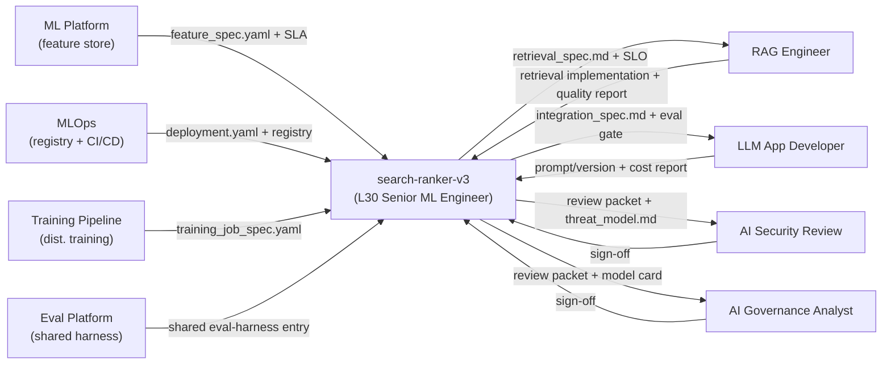

# exercise-02 — Role Hand-Off Map (Reference Solution)

Paired exercise: `lessons/mod-301-senior-ml-role-scope/exercises/exercise-02-role-hand-off-map.md`.
Paired chapters: `04-hand-off-contracts.md`, `02-altitude-and-ownership.md`.

## 1. Solution overview

This exercise produces `hand-off-map.md` — a system spec, a ≥8-row contract table across the three neighbour categories, a boundary diagram with correctly-directed arrows, and a 2–4 paragraph reflection on scope-creep and scope-punt. The reference below walks through a fully-worked **illustrative** example for a marketplace-search ranking system (the first fallback system in the exercise brief), so the shape of a graded artefact is explicit. Learners will substitute their own system.

The hand-off map is the load-bearing L30 artefact for cross-team scope: it tells a design-review audience what stays inside the senior's ownership boundary (architecture, SLOs, integration decisions, review-packet authorship) and what sits on the other side of a contract with a peer platform / peer specialist / review counterpart (ch.04). The reflection, not the table, is the calibration — the table is just the context the reflection stands on.

## 2. Implementation (worked answer — illustrative marketplace search ranker)

### 2.1 System spec

Illustrative target system; substitute your own when you run the exercise.

- **Description.** `search-ranker-v3` ranks the top-100 marketplace listings returned by the retrieval service on every search impression. A gradient-boosted model consumes ~80 features (query / listing / query×listing / seller trust) at ~50 ms P95, serving ~1 B impressions/week. Business metric: Search → Listing-click rate (SLCR) with a secondary gross-booking-value guardrail.
- **Team boundary.** Ranker pod inside Search ML: two mid-level ML engineers + one senior ML engineer (the L30 role this map is drawn from). Adjacent product squad on the Search page, platform engineering one floor over, responsible-AI/governance in a separate org.
- **Lifecycle stage.** In-production for ~5 quarters; v3 is the current head, v2 is the fallback. Not yet "mature" — SLO authoring and incident-response craft are both still being iterated on (relevant for the reflection below).
- **Why it exists.** Converting more of the 1 B weekly searches into relevant bookings; SLCR is the primary metric, fairness-slice retention and query-latency P95 are the two guardrails product has signed off on.

### 2.2 Relevant neighbouring tracks

Chapter 04 names three categories of neighbour. For this illustrative system, the relevant tracks are:

| Peer track | Category |
|---|---|
| `ai-infra-ml-platform-learning` (feature store) | Peer platform (paved-road consumption) |
| `ai-infra-mlops-learning` (model registry + CI/CD for ML) | Peer platform |
| `training-pipeline-engineer-learning` (distributed training) | Peer platform |
| `model-evaluation-engineer-learning` (shared eval harness) | Peer platform |
| `rag-engineer-learning` (if a semantic-retrieval leg is added) | Peer specialist (delegation) |
| `llm-application-developer-learning` (if an LLM reranker is layered in H2) | Peer specialist |
| `ai-infra-security-learning` | Review counterpart |
| `ai-governance-analyst-learning` | Review counterpart |

Two neighbour categories (training pipeline, fine-tuning) that would appear if the system moved from "in-production" → "mature" are listed in the table below as *lifecycle-stage* rows so the map still covers all three categories ≥8 rows.

### 2.3 Contract table (9 rows)

| # | Peer track | Category | You own (L30) | They own | Interface artefact | One realistic failure mode | Guardrail |
|---|---|---|---|---|---|---|---|
| 1 | `ai-infra-ml-platform-learning` | Peer platform | Spec for `search_query_ctr_1d`; the 30-min freshness SLO; consumer config for the feature store; contribute-back RFC if a feature type is missing. | The feature store itself, its multi-tenant compute, its SLA, the shared registry UI. | `feature_spec.yaml` in the shared feature registry + platform SLA doc. | Feature store publishes `search_query_ctr_1d` on a 1 h freshness SLA while the retrainer assumes 15 min — silent training/serving skew. | Freshness alarm on the ranker-side consumer; retraining job asserts feature-timestamp window in a pre-flight; freshness SLO co-owned in `feature_spec.yaml`. |
| 2 | `ai-infra-mlops-learning` | Peer platform | Deployment spec; canary plan at 1%→10%→50%; shadow traffic plan; retraining trigger definition; roll-back plan to v2. | CI/CD for ML; shared model registry; retraining orchestration primitives; artifact storage. | `deployment.yaml` + registry entry + on-call runbook. | A failed canary rolls back the deploy but leaves retraining pointed at the new feature set, so v2 silently retrains on v3 features. | Canary rollback also pins the retraining branch to v2's feature-set revision; registry entry records the feature-set hash; alert fires when they diverge. |
| 3 | `model-evaluation-engineer-learning` | Peer platform | Slice definitions (new-query, long-tail seller, non-EN query); holdout construction; adversarial cases; review-packet template. | The eval harness itself; the LLM-judge platform; shared eval infra; cost accounting for eval runs. | `slice_spec.yaml` + rubric + shared eval-harness entry. | Eval harness runs only the aggregate SLCR metric on the nightly job; long-tail-seller slice silently regresses under v3 and is not caught until a product-partner escalation. | Per-slice regression alert wired to the nightly eval; release gate blocks deploy if any slice drops >2σ from its 30-day baseline. |
| 4 | `training-pipeline-engineer-learning` *(lifecycle: at "mature" stage, this becomes load-bearing)* | Peer platform | Training job spec; dataset lineage doc; resource envelope (GPU hours, max wall-clock); priority tier; cost budget. | Distributed-training platform; GPU cluster ops; NCCL tuning; scheduling; chargeback. | `training_job_spec.yaml` + cost budget + escalation path. | Priority tier is unset, retraining gets pre-empted during a quarterly re-ranking push and misses the retrain SLA. | Explicit priority tier in the job spec; retrain-SLA alert owned by the ranker pod; chargeback dashboard reviewed monthly. |
| 5 | `rag-engineer-learning` *(delegation contract, enabled when the semantic-retrieval leg lands)* | Peer specialist | RAG-adoption decision; retrieval-quality SLO (recall@100 ≥ X on the review set); eval slice set for retrieval; integration surface with the ranker. | Retrieval architecture depth; chunking/embedding choices; retrieval-infra operations. | `retrieval_spec.md` + retrieval-quality SLO + eval slice set. | Retrieval team ships an embedding migration; retrieval-quality SLO is held but recall shifts composition in a way the ranker's feature relies on — silent downstream skew. | Shadow-traffic eval on the ranker side against the new retrieval build; retrieval-quality SLO explicitly includes composition stability, not only recall. |
| 6 | `llm-application-developer-learning` *(delegation, enabled when an LLM reranker lands in H2)* | Peer specialist | Integration decision (prompt vs. RAG vs. fine-tune vs. hybrid); cost/latency guardrails; integration surface; eval gate for the reranker stage. | Prompt engineering depth; agentic flows; LLM app framework depth. | `integration_spec.md` + prompt-version registry + eval gate. | LLM reranker is wired in behind a naive cost budget; token spend 10× at a seasonal traffic spike and the finance alert fires before the engineer notices. | Hard cost budget enforced upstream with a cut-off to the deterministic ranker; P95 latency SLO on the combined stage; cost dashboard reviewed weekly. |
| 7 | `ai-infra-security-learning` | Review counterpart | Data-lineage & PII inventory for the ranker feature set; threat-model draft (model extraction via ranker-score leakage, poisoning via seller-trust features); mitigation plan. | Deep ML/AI security review; ATLAS-referenced adversarial-input analysis; final sign-off. | Review packet section + `threat_model.md` + sign-off record. | Threat-model draft is skipped because "this is just a ranker"; security review is handed a raw model card and asked to sign; review stalls or signs a packet with missing controls. | Review packet template requires the threat-model section to be present and non-empty; model extraction and data-poisoning classes are covered against MITRE ATLAS references; packet cannot be submitted without a completed section. |
| 8 | `ai-governance-analyst-learning` | Review counterpart | Model card; data statement; fairness / robustness slice results; retention / review-cadence artefact. | Governance framework; compliance sign-off; policy authorship. | Review packet section + governance sign-off record. | A new high-impact use of the ranker (e.g. ranking newly-regulated seller categories) ships without updating the model card or re-opening the governance review. | Change-impact checklist tied to NIST AI RMF function categories; model-card updates are a release-gate; governance re-review required when the use-case material changes. |
| 9 | `ai-infra-mlops-learning` (incident contract) | Peer platform (expanded for lifecycle: "in-production" → "mature") | Freshness SLO, P95 latency SLO, quality SLO, incident commander for ML-side regressions; retro authorship. | Shared on-call runbooks, paging primitives, status-page integration. | On-call runbook + SLO policy + retro archive. | Freshness SLO is written, but the alert threshold is set too loose; a slow data-pipeline degradation does not page and surfaces as a product-partner complaint. | Error-budget-driven thresholds reviewed quarterly; freshness SLO and alert threshold co-authored; retro loop closes with a structural fix, not just a hotfix. |

Note on "You own" phrasing: per the exercise brief, each cell is restated in the system's vocabulary — not pasted from the chapter 04 reference. If every cell in your table reads identical to chapter 04, the table has not been grounded in the target system.

### 2.4 Boundary diagram

Mermaid is the preferred format; a hand-drawn photo is also acceptable. Arrow direction is **from the party who authors the interface artefact to the party who reviews or consumes it** (per the exercise brief). The author-side is where ownership sits for that artefact.



Readings to apply when drawing your own:

- An arrow *into* the ranker from a peer platform node encodes "you are the consumer of a paved road." Your ownership is the spec and SLO on the consumer side, not the platform itself.
- An arrow *from* the ranker into a peer specialist node encodes the delegation spec you author. The return arrow is the depth artefact they author back to you.
- Both arrows between the ranker and each review counterpart matter — one is packet authorship (yours), one is sign-off (theirs). Omitting the return arrow is the "I'll just sign it" anti-pattern in picture form.

### 2.5 Reflection (illustrative, 3 paragraphs)

> **Most likely scope-creep contract: the eval harness (`model-evaluation-engineer-learning`).** Honest reason: the shared eval harness does not yet support the long-tail-seller slice as a first-class slice type, and my instinct is to hand-roll a slice runner inside the ranker pod and be done by Friday. This is the "I'll just build it" anti-pattern from chapter 04 — six months later the pod owns an unmaintained slice runner that the rest of the org cannot reuse. The honest fix is a contribute-back RFC to the eval platform (mod-308), not a shadow harness.
>
> **Most likely scope-punt contract: the security review packet (`ai-infra-security-learning`).** Honest reason: I have never authored a threat-model draft and my default is to hand the model card to security and hope. That is the "I'll just sign it" anti-pattern (ch.04). The ranker genuinely does have a model-extraction surface (scores leak to a public API consumer) and a data-poisoning surface (seller-trust features are seller-authored), so a security reviewer cannot do their job from a raw model card. The threat-model draft must be mine.
>
> **Implied growth-plan change (feeds exercise-03):** invest in mod-308 to close the contribute-back RFC muscle for the eval-slice issue, and invest in mod-309 to close the threat-model authorship gap for the review packet. The hand-off map says my weakest contracts are on Competency D (Cross-team & Governance) — this is the input I will carry into exercise-03's self-assessment and expect Competency D to have the biggest gap.

## 3. Validation steps

Before considering the map done, walk through this checklist on the artefact:

1. **System spec is non-generic.** The one-paragraph description names a specific feature, metric, and SLO (or clearly-labeled illustrative stand-in). A reviewer cannot audit a map without the underlying system.
2. **All three neighbour categories are represented.** At least one peer-platform row, at least one peer-specialist row, and at least two review-counterpart rows (security + governance).
3. **Table has ≥8 rows.** If the system genuinely has fewer than 8 live neighbours, the table includes lifecycle-stage rows for the next stage and marks them as such.
4. **"You own" cells are restated in your system's vocabulary.** A random spot-check: pick any row, ask "could this row apply to any ML system in the industry unchanged?" If yes, it is pasted from chapter 04 and needs to be grounded.
5. **Every row has a concrete failure mode and a concrete guardrail.** "Communication breakdown" is not a failure mode; "the retraining trigger assumes 15-min freshness but the feature store publishes at 1 h" is. "Communicate more" is not a guardrail; "freshness alarm wired to the consumer SLO plus pre-flight assertion in the retrainer" is.
6. **Diagram arrow directions match the brief.** Peer-platform arrows go *into* you; delegation arrows go *out of* you and *back*; review-counterpart arrows are paired (author-out + sign-off-back).
7. **Diagram arrows are annotated with the interface artefact name from your table.** Unannotated arrows cannot be audited against the table.
8. **Reflection names a specific neighbour.** "I might scope-creep sometimes" is not acceptable; "I would hand-roll the eval slice runner because the shared harness does not support long-tail-seller as a slice type" is.
9. **Reflection ties to exactly one implied growth-plan change.** This is the hand-off map's job as an input to exercise-03.

Static check:

```bash
# From the artefact's directory.
grep -c "^| " hand-off-map.md     # expect ≥ 9 pipe-rows (header + >=8 data rows)
grep -c "scope-creep\|scope-punt" hand-off-map.md  # expect ≥ 2 (one per axis)
# Mermaid syntax (if you render locally):
npx -p @mermaid-js/mermaid-cli mmdc -i hand-off-map.md -o /tmp/out.svg  # optional: catches arrow-direction typos
```

## 4. Rubric / review checklist

- [ ] System spec: paragraph + boundary metadata + lifecycle stage + primary product metric.
- [ ] Neighbouring-track list with category tag (peer platform / peer specialist / review counterpart) per track.
- [ ] Contract table ≥ 8 rows, all three categories represented.
- [ ] Every row has non-generic `You own` restated for this system.
- [ ] Every row has a concrete, specific failure mode (not "communication breakdown").
- [ ] Every row has a concrete, specific guardrail (dashboard, alert, pre-flight, review gate — not "communicate more").
- [ ] Boundary diagram present, ranker in the centre, every neighbour box drawn.
- [ ] Arrow direction follows authorship: paved-road inbound, delegation out-and-back, review-packet out with sign-off back.
- [ ] Every arrow annotated with the interface artefact name from the table.
- [ ] Reflection names the most likely scope-creep neighbour and one honest reason.
- [ ] Reflection names the most likely scope-punt neighbour and one honest reason.
- [ ] Reflection ends with one concrete growth-plan change for exercise-03.
- [ ] If stretch goals attempted: cross-check against an L30 posting from exercise-01 is a distinct section, not folded into the main reflection.
- [ ] If stretch goals attempted: contract-versus-reality column (`clean` / `informal` / `broken`) is present and non-trivially filled.

Review-weighted points (for use when grading):

- Contract table completeness and groundedness: 40%
- Failure-mode + guardrail concreteness: 25%
- Diagram correctness (arrow direction + annotations): 15%
- Reflection honesty and actionability: 20%

## 5. Common mistakes

- **Pasting chapter 04's "you own" cells unchanged.** The table reads plausible but is not grounded in the target system. If every row could be swapped between two learners' systems, nobody has ground-truthed theirs.
- **Generic failure modes.** "Lack of alignment", "communication breakdown", "unclear ownership" are not failure modes — they are categories that failure modes belong to. The failure mode must say which artefact fails, in which direction, with what observable consequence.
- **Guardrails that are process, not product.** "We will have a sync" is not a guardrail. A guardrail is a dashboard, an alert, a pre-flight assertion, a release gate, or a contract version-bump that automatically triggers review.
- **Arrow direction backwards on peer-platform rows.** Drawing the arrow from the ranker to the feature store makes it look like the ranker authors the feature store — the reverse of the paved-road contract and the single easiest way to mis-signal L20 scope in a design review.
- **Omitting the return arrow on review-counterpart rows.** The one-way arrow is the "I'll just sign it" anti-pattern (ch.04). Author-and-sign is two distinct interface events; both must appear.
- **Including every peer track whether or not it is relevant.** A pure tabular ranker probably has no fine-tuning neighbour. Padding the table with irrelevant tracks dilutes the signal; use lifecycle-stage rows instead.
- **A reflection that says "both scope-creep and scope-punt equally."** The exercise forces a choice because the choice is the calibration. A learner who cannot pick has not been honest with themselves yet.
- **Tying the reflection to a competency that is not named anywhere in the chapter 05 competency map.** The implied growth-plan change must map to one of Architecture / Evaluation / Reliability / Cross-team / Leadership.

## 6. References

Official standards (governance review packet references these in row 7 and row 8):

- OWASP Machine Learning Security Top 10 — <https://owasp.org/www-project-machine-learning-security-top-10/>. The threat-model section in the security review packet is expected to cover the applicable items from this top-10.
- MITRE ATLAS — <https://atlas.mitre.org/>. Adversarial-input / model-extraction / data-poisoning references in the threat-model draft are expected to cite relevant ATLAS techniques.
- NIST AI Risk Management Framework — <https://www.nist.gov/itl/ai-risk-management-framework>. The governance row's change-impact checklist is expected to tie to the NIST AI RMF function categories (Govern / Map / Measure / Manage).

Local context (authoritative for the hand-off taxonomy and worked example):

- Paired lesson: `lessons/mod-301-senior-ml-role-scope/exercises/exercise-02-role-hand-off-map.md`.
- Chapter 04 — Hand-off contracts to peer tracks: `lessons/mod-301-senior-ml-role-scope/04-hand-off-contracts.md`. Source of the three neighbour categories, the contract-table columns (`You own` / `They own` / `Interface` / `Module`), the paved-road / delegation / packet-authorship postures, and the three anti-patterns referenced in the reflection.
- Chapter 02 — Altitude and ownership: `lessons/mod-301-senior-ml-role-scope/02-altitude-and-ownership.md`. Source of the five ownership axes the "You own" column rests on.
- Paired solution: `modules/mod-301-senior-ml-role-scope/exercise-03-self-assessment-and-growth-plan/SOLUTION.md`. The hand-off map's reflection feeds the Competency D rating in the growth plan.
